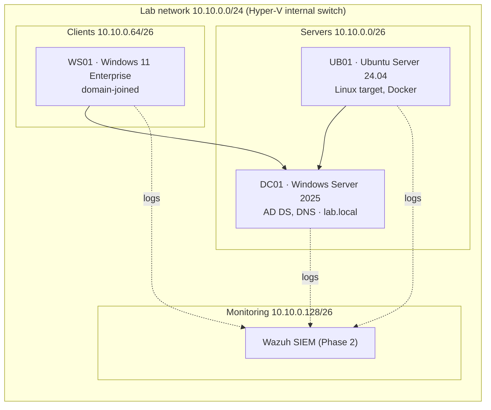

# Security Homelab

Hands-on lab where I build, attack, and defend a small corporate network, following a 9-month path from IT support to security analyst and cloud security engineer.

## Lab network

Isolated Hyper-V internal switch, no route to my home network.

## Roadmap

| Phase | Weeks | Focus | Milestone |
|---|---|---|---|
| 1 · Foundations | 1–13 | Networking, AD & GPO hardening, Linux, scripting, Docker | CompTIA Security+ |
| 2 · Defense | 14–25 | SIEM (Wazuh, Sentinel/KQL), Sysmon, AD attacks & detection, incident response | Microsoft SC-200 |
| 3 · Cloud | 26–38 | Entra ID hardening, Terraform, Kubernetes, Defender for Cloud | Cloud security cert |

## Weekly log

- [x] **Week 01** — Lab design, Hyper-V setup, OSI/TCP-IP and subnetting
- [ ] Week 02 — Packet analysis with Wireshark
- [ ] Week 03 — Active Directory from scratch (DC01 already built: see below)

## Build log

| Script | What it does |
|---|---|
| [`01-new-dc01.ps1`](scripts/01-new-dc01.ps1) | Private Hyper-V switch (no path to host or home network) + DC01 VM, Gen 2 with Secure Boot |
| [`02-install-dc01.ps1`](scripts/02-install-dc01.ps1) | Installs Windows Server 2025 without the wizard: DISM image apply + `unattend.xml` |
| [`03-promote-dc01.ps1`](scripts/03-promote-dc01.ps1) | Static IP 10.10.0.10/26 and promotion to first DC of `lab.local`, all through PowerShell Direct |
| [`04-new-ws01.ps1`](scripts/04-new-ws01.ps1) | WS01, Windows 11 Pro with vTPM, built end to end; static IP 10.10.0.30 (servers /26 until the lab router exists) |
| [`05-capture-ws01-dc01.ps1`](scripts/05-capture-ws01-dc01.ps1) | Week 2: `pktmon` capture inside WS01 while generating DNS, LDAP, SMB and ICMP to DC01 |

### Week 02 findings (WS01 not domain-joined yet)

- No Kerberos at all: auth fell back to **NTLM** because WS01 is not joined and the account was given as `LAB\Administrator`.
- DC01 logged `4625` for `WS01\labadmin` with SubStatus `0xc0000064` (user does not exist): Windows first tried the workstation's own local account, then `4624` type 3 for `LAB\Administrator`.
- DC01 requires SMB signing (`RequireSecuritySignature: True`), which blocks NTLM relay over SMB.
- Open question: mapping `\\dc01\SYSVOL` returned *Access is denied* even after a successful `4624`. The capture shows the SMB side worked (DFS referral `STATUS_NOT_FOUND`, then Tree Connect to SYSVOL `STATUS_SUCCESS`); right after, the client fell back to WebDAV on TCP 80 and got 5 unanswered SYNs (1/2/4/8 s backoff, DC firewall drops). The error is client-side, not a share permission. To retest after the domain join.

Lessons so far:
- Defender's ASR rule *Block abuse of exploited vulnerable signed drivers* fired while DISM wrote `KslD.sys` into the VM disk. Benign in context (OS image apply), but it is the same rule that stops BYOVD attacks.
- `hypervisorlaunchtype` was `Off` in the host's BCD, so VMs could not start even with SVM enabled in BIOS.
- An `unattend.xml` left in `C:\Windows\Panther` holds the local admin password (MITRE ATT&CK T1552.001). Kept on purpose in this lab to hunt for it in Phase 2.

## Rules

- All attack techniques run only inside this isolated lab.
- No real credentials, company data, or production systems.
