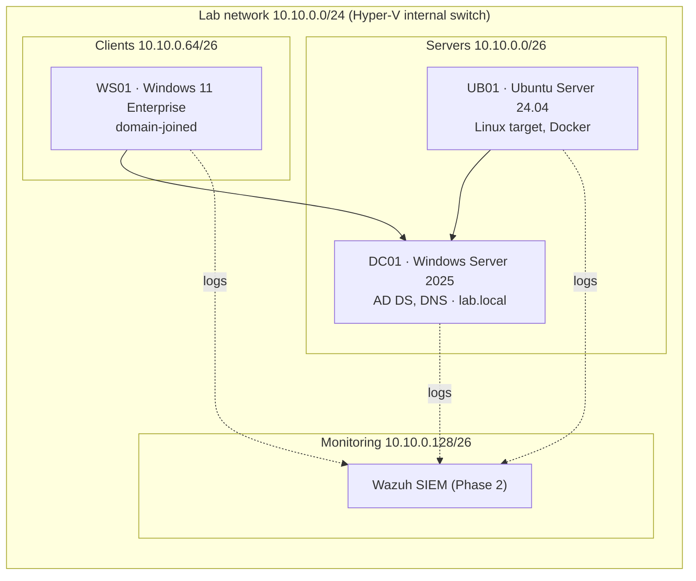

# Security Homelab

Hands-on lab where I build, attack, and defend a small corporate network, following a 9-month path from IT support to security analyst and cloud security engineer.

## Lab network

Isolated Hyper-V internal switch, no route to my home network.

## Roadmap

| Phase | Weeks | Focus | Milestone |
|---|---|---|---|
| 1 · Foundations | 1–13 | Networking, AD & GPO hardening, Linux, scripting, Docker | CompTIA Security+ |
| 2 · Defense | 14–25 | SIEM (Wazuh, Sentinel/KQL), Sysmon, AD attacks & detection, incident response | Microsoft SC-200 |
| 3 · Cloud | 26–38 | Entra ID hardening, Terraform, Kubernetes, Defender for Cloud | Cloud security cert |

## Weekly log

- [ ] **Week 01** (in progress) — Lab design, Hyper-V setup, OSI/TCP-IP and subnetting
- [ ] Week 02 — Packet analysis with Wireshark
- [ ] Week 03 — Active Directory from scratch

## Rules

- All attack techniques run only inside this isolated lab.
- No real credentials, company data, or production systems.
