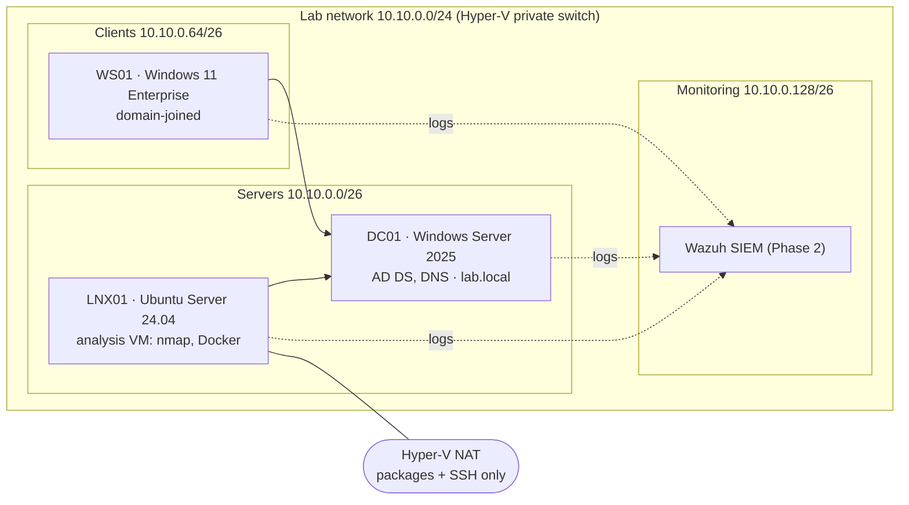

# Security Homelab

Hands-on lab where I build, attack, and defend a small corporate network, following a 9-month path from IT support to security analyst and cloud security engineer.

## Lab network

Isolated Hyper-V private switch, no route to my home network. The one exception is LNX01's second NIC on Hyper-V's NAT switch, used only to pull packages and to SSH in from the host; it does not forward between its NICs (`FORWARD` policy `DROP`, verified week 9).

## Roadmap

| Phase | Weeks | Focus | Milestone |
|---|---|---|---|
| 1 · Foundations | 1–13 | Networking, AD & GPO hardening, Linux, scripting, Docker | CompTIA Security+ |
| 2 · Defense | 14–25 | SIEM (Wazuh, Sentinel/KQL), Sysmon, AD attacks & detection, incident response | Microsoft SC-200 |
| 3 · Cloud | 26–38 | Entra ID hardening, Terraform, Kubernetes, Defender for Cloud | Cloud security cert |

## Weekly log

- [x] **Week 01** — Lab design, Hyper-V setup, OSI/TCP-IP and subnetting
- [x] **Week 02** — Packet analysis with Wireshark (NTLM vs Kerberos, see findings below)
- [x] **Week 03** — Active Directory from scratch: OUs, groups, users, service account, WS01 domain join
- [x] **Week 04** — GPO hardening: password/lockout policy, RC4 off (AES only), LLMNR off, SMB signing, advanced audit
- [x] **Week 05** — Validated the AES-only control: requested a service ticket, confirmed AES (not RC4) in the ticket and in 4769, hardened the service account to AES-only
- [x] **Week 06** — Windows LAPS: each workstation's local-admin password is now unique, rotated, and stored encrypted in AD
- [x] **Week 07** — Centralize logs (Phase 2 begins): Sysmon on DC01 + WS01, Windows Event Forwarding to one collector
- [x] **Week 08** — Threat hunting over the central logs: four hunts (encoded PowerShell, scripts in Temp, failed-logon bursts, odd DNS); the hunt exposed that the week 4 audit baseline had never actually applied, now fixed and verified
- [x] **Week 09** — Attack surface review: built an Ubuntu analysis VM, mapped every open port on DC01 and WS01 with Nmap, and decided what to close
- [x] **Week 10** — Vulnerability scanning: Greenbone Community (OpenVAS) in Docker on LNX01, unauthenticated Full-and-fast scan, fixed the top findings and re-scanned: 2 medium + 2 low down to 1 accepted medium

## Build log

| Script | What it does |
|---|---|
| [`01-new-dc01.ps1`](scripts/01-new-dc01.ps1) | Private Hyper-V switch (no path to host or home network) + DC01 VM, Gen 2 with Secure Boot |
| [`02-install-dc01.ps1`](scripts/02-install-dc01.ps1) | Installs Windows Server 2025 without the wizard: DISM image apply + `unattend.xml` |
| [`03-promote-dc01.ps1`](scripts/03-promote-dc01.ps1) | Static IP 10.10.0.10/26 and promotion to first DC of `lab.local`, all through PowerShell Direct |
| [`04-new-ws01.ps1`](scripts/04-new-ws01.ps1) | WS01, Windows 11 Pro with vTPM, built end to end; static IP 10.10.0.30 (servers /26 until the lab router exists) |
| [`05-capture-ws01-dc01.ps1`](scripts/05-capture-ws01-dc01.ps1) | Week 2: `pktmon` capture inside WS01 while generating DNS, LDAP, SMB and ICMP to DC01 (`-Tag w03` reruns it after the join) |
| [`06-ad-structure.ps1`](scripts/06-ad-structure.ps1) | Week 3: OU tree, `GG-*` department groups, 4 staff users, a separate `adm.*` admin account, `svc_sql` with an SPN; `redircmp` so new computers land in an OU where GPOs apply |
| [`07-join-ws01.ps1`](scripts/07-join-ws01.ps1) | Week 3: joins WS01 to `lab.local`, reboots, checks the secure channel and `nltest /dsgetdc` |
| [`08-gpo-hardening.ps1`](scripts/08-gpo-hardening.ps1) | Week 4: four baseline GPOs — AES-only Kerberos (kills RC4), LLMNR off, SMB signing, advanced audit + 4688 command line |
| [`09-validate-aes-control.ps1`](scripts/09-validate-aes-control.ps1) | Week 5: requests a service ticket from WS01, confirms it is issued as AES-256 (not RC4) in the ticket and in event 4769, then pins the service account to AES-only |
| [`10-windows-laps.ps1`](scripts/10-windows-laps.ps1) | Week 6: Windows LAPS — extend schema, grant computer self-write, GPO to back up the local-admin password to AD, force WS01 to rotate, read it back |
| [`11-sysmon.ps1`](scripts/11-sysmon.ps1) | Week 7: downloads Sysmon on the host (signature checked), pushes it into DC01/WS01 over PowerShell Direct with a small config, proves event 1 is logged |
| [`12-event-forwarding.ps1`](scripts/12-event-forwarding.ps1) | Week 7: DC01 becomes a Windows Event Collector; source-initiated subscription + GPO so workstations push Sysmon and key Security events to it |
| [`13-threat-hunting.ps1`](scripts/13-threat-hunting.ps1) | Week 8: WS01 produces harmless look-alike activity; four hunts on DC01 find it (`-HuntOnly` reruns just the searches) |
| [`14-fix-audit-gap.ps1`](scripts/14-fix-audit-gap.ps1) | Week 8: registers the missing audit extension in the week 4 GPO, links it on the DC OU, proves failed Kerberos/credential events are now logged |
| [`15-new-lnx01.ps1`](scripts/15-new-lnx01.ps1) | Week 9: LNX01, Ubuntu Server 24.04 analysis VM, unattended (Subiquity autoinstall from a `CIDATA` disk); lab NIC + NAT NIC matched by MAC; nmap and Docker preinstalled, SSH key only |
| [`16-greenbone-scan.sh`](scripts/16-greenbone-scan.sh) | Week 10 (runs on LNX01): creates the Greenbone target + task once, starts a run, polls until it ends, saves the XML report and a one-line-per-finding summary (QoD ≥ 70) |
| [`17-fix-week10.ps1`](scripts/17-fix-week10.ps1) | Week 10: scope WS01's RPC/WinRM inbound rules to DC01, disable CDPSvc, TCP timestamps and NetBIOS over TCP/IP on DC01 + WS01 |

### Week 02 findings (WS01 not domain-joined yet)

- No Kerberos at all: auth fell back to **NTLM** because WS01 is not joined and the account was given as `LAB\Administrator`.
- DC01 logged `4625` for `WS01\labadmin` with SubStatus `0xc0000064` (user does not exist): Windows first tried the workstation's own local account, then `4624` type 3 for `LAB\Administrator`.
- DC01 requires SMB signing (`RequireSecuritySignature: True`), which blocks NTLM relay over SMB.
- Open question: mapping `\\dc01\SYSVOL` returned *Access is denied* even after a successful `4624`. The capture shows the SMB side worked (DFS referral `STATUS_NOT_FOUND`, then Tree Connect to SYSVOL `STATUS_SUCCESS`); right after, the client fell back to WebDAV on TCP 80 and got 5 unanswered SYNs (1/2/4/8 s backoff, DC firewall drops). The error is client-side, not a share permission. To retest after the domain join.

### Week 03 findings (after the domain join)

- Same traffic, now **Kerberos**: 18 Kerberos packets and DC01 logs `4768` (TGT) + `4769` (service tickets for `ldap/dc01` and `cifs/DC01`), with `4624` showing `Kerberos` instead of `NTLM`.
- First AS-REQ gets `KDC_ERR_PREAUTH_REQUIRED` (error 25) on purpose: the client must prove it knows the password first. Accounts with pre-auth disabled are the AS-REP roasting target.
- Tickets use etype 18 (AES256), but the KDC still advertises 23 (RC4) as an option: RC4 tickets are what Kerberoasting cracks fastest.
- `\\dc01\SYSVOL` now mounts fine: the week 2 *Access is denied* was tied to the non-joined NTLM path.
- `svc_sql` has a deliberately weak password and an SPN, kept for the Kerberoasting exercise in Phase 2.

### Week 04 findings (GPO hardening)

- Four GPOs linked at the domain root; verified applied on WS01 with `gpresult /r`.
- `SupportedEncryptionTypes = 0x18` (24): Kerberos now negotiates **AES only**. RC4 — the fast Kerberoasting path from week 3 — is gone from the offer.
- LLMNR off (`EnableMulticast = 0`): removes the multicast name-resolution request that Responder-style tools poison to capture hashes.
- SMB signing required on client and server: blocks NTLM-over-SMB relay.
- Advanced audit baseline + `ProcessCreationIncludeCmdLine_Enabled = 1`, so 4688 records the full command line — the single most useful event for threat hunting.
- Password policy follows NIST guidance: 14-char minimum, lockout after 5 tries, length over forced rotation (365-day max age).

### Week 05 findings (validating the AES-only control)

- A domain user on WS01 requested a service ticket for `MSSQLSvc/sql01.lab.local:1433`. The KDC issued it as **AES-256**, and `klist` confirmed `KerbTicket Encryption Type: AES-256-CTS-HMAC-SHA1-96`.
- DC01 logged **4769** with `TicketEncryptionType = 0x12` (AES256). `0x17` would have been RC4 — the fast offline-cracking path that week 3's capture showed being offered.
- The service account had `msDS-SupportedEncryptionTypes` unset (AES only by Server 2025 default). Pinned it explicitly to `0x18` (AES128+AES256) so RC4 can never be negotiated even if the GPO changes — the standard mitigation for this class of attack, alongside long/managed service-account passwords (gMSA).
- Done entirely with built-in Windows tools from a box already on the isolated switch; no extra VM needed.

### Week 06 findings (Windows LAPS)

- `Update-LapsADSchema` added the LAPS attributes; `Set-LapsADComputerSelfPermission` lets a computer write (not read) its own password.
- GPO on the Workstations OU: back up to AD, manage the local `labadmin` account, 20-char password, 30-day rotation.
- After `Invoke-LapsPolicyProcessing`, WS01's local-admin password was rotated and stored in AD. `Get-LapsADPassword -Identity WS01` reads it back as a domain admin — length 20, with the next expiry recorded.
- Consequence to remember: WS01's local `labadmin` password is now LAPS-managed, so the value in the lab creds file is stale — retrieve the current one from AD on demand.
- This kills lateral movement via a shared local-admin password: every machine ends up with a different one.

### Week 07 findings (Sysmon, part 1)

- Sysmon 15.22 (Authenticode signature `Valid`) installed as a service on both machines; the lab switch has no Internet, so it is copied in over PowerShell Direct.
- Config is small on purpose: process creation (1) with full command line and parent, network connections (3), lsass access (10), files dropped in Temp/Downloads/AppData (11), DNS queries with the asking process (22).
- Proof: `whoami /groups` run from PowerShell shows up in `Microsoft-Windows-Sysmon/Operational` with image, parent (`powershell.exe`) and command line — the parent/child chain that 4688 alone cannot give.

### Week 07 findings (event forwarding, part 2)

- DC01 is the collector (`ForwardedEvents` log). The subscription is **source-initiated**: a GPO on the Workstations OU points each machine at `dc01.lab.local:5985`, and `Domain Computers` are allowed as sources, so adding a PC needs no change on the collector.
- Forwarded: every Sysmon event plus Security 4624/4625 (logons), 4688 (process start), 4768/4769 (Kerberos), 4720/4732 (account and group changes).
- First attempt failed even though the network was fine: the forwarder runs as *Network Service*, which had no read access to the Sysmon channel (`query returns no active channel`, error 5004). Fix: add `(A;;0x1;;;NS)` to the channel's SDDL and add Network Service to *Event Log Readers* for the Security log. Lesson: WEF problems live in the collector's `EventCollector/Operational` and the source's `Forwarding/Operational` logs, not in the network.
- Verified end to end: events generated on WS01 appear on DC01 within seconds, from WS01 only.

### Week 08 findings (threat hunting)

Method: WS01 generates four harmless look-alike activities (every command only runs `whoami`, writes a line of text, or resolves a name); DC01 is then searched. A hunt that returns nothing means a logging gap.

| Hunt | Pattern | Source | Result |
|---|---|---|---|
| H1 | PowerShell with `-EncodedCommand` (T1059.001 / T1027) | Sysmon 1 / Security 4688 | Found, with parent process and command line |
| H2 | Script dropped in a user-writable folder | Sysmon 11 | Found, after excluding PowerShell's own `__PSScriptPolicyTest` and `ModuleAnalysisCache` noise |
| H3 | Failed sign-ins for one account, network type 3 | Security 4625 on DC01 | Found only after lowering the threshold: 6 attempts produced 3 events ~45 s apart, so a threshold of 5 missed it |
| H4 | DNS lookup outside the lab domain, with the asking process | Sysmon 22 | Found; browser and OneDrive lookups are the baseline noise |

- **False positives are the job.** PowerShell Direct logs a 4625 for `<PSDirectVMLegacy>` (logon type 2, SID `S-1-0-0`) every time a session starts; the context (account name, type, timing) is what separates it from a real attack.
- **Audit baseline had never applied.** The week 4 GPO showed as applied in `gpresult`, but its `audit.csv` was written straight into SYSVOL without registering the Audit Policy Configuration extension (`{F3CCC681-...}`) in `gPCMachineExtensionNames`, so no machine read it. Failed Kerberos requests and credential validations were silently not logged. Fixed in `14-fix-audit-gap.ps1`, then verified: `auditpol` shows Success and Failure on both machines and a sign-in with a nonexistent user now leaves 4768 (status `0x6`) and 4776. Lesson: verify a control by its effect, not by "the policy is applied".
- **Collector stability.** Filtering `ForwardedEvents` by event ID hung and then crashed the EventLog service on a 4 GB DC01 (`RPC server is unavailable`); the same read without a filter returns in a second. The hunts read unfiltered and filter client-side, and DC01 now has 6 GB.

### Week 09 findings (attack surface with Nmap)

Scans from LNX01 (10.10.0.40), raw output in [`scans/week09/`](scans/week09/): ARP discovery of the /26, SYN scan of all 65,535 TCP ports, `-sV -sC` on what was open, and the main UDP ports.

- **Discovery:** 3 hosts up. WS01 blocks ping but answered ARP; on a local segment, "doesn't ping" never means "not there".
- **DC01:** 21 TCP ports, all expected for a domain controller (53 DNS, 88 Kerberos, 135/593 RPC, 139 NetBIOS, 389/636 LDAP, 445 SMB, 464 kpasswd, 3268/3269 Global Catalog, 5985 WinRM, 9389 AD Web Services, eight dynamic RPC ports in 49xxx). UDP: 53, 88, 123, 137, 389 open.
- **WS01:** only 135, 5040 and 5985 answer; the other 65,532 are filtered by the Windows firewall.

What I would close, highest risk first:

| # | Finding | Why it matters | Fix |
|---|---|---|---|
| 1 | WS01 accepts WinRM (5985) and RPC (135) from any lab host | Workstation-to-workstation remote management is the classic lateral-movement path (ATT&CK T1021.006). Event forwarding only needs WS01 to connect *out* to DC01. | Firewall scope on workstations: allow 5985/135 inbound only from an admin host; remove the WinRM listener if nothing manages WS01 remotely |
| 2 | NetBIOS name service open on DC01 (137/udp, 139/tcp); `nbstat` leaked its name and MAC | Week 4 turned LLMNR off, but NBT-NS poisoning is the same attack over the other fallback protocol, so that control was only half done | Disable NetBIOS over TCP/IP on every NIC (GPO startup script or DHCP option 001) |
| 3 | LDAPS (636) and GC over TLS (3269) show as `tcpwrapped` | Most likely the DC has no certificate, so TLS can't start: directory traffic is only on plain 389, and any simple bind would cross the wire in clear text | Issue the DC a certificate (AD CS in a later week), then require LDAP signing and channel binding |
| 4 | WinRM (5985) on DC01 reachable from every host | Needed for administration, but the DC should only be managed from admin machines | Firewall scope to admin hosts |
| 5 | WS01 port 5040 (Connected Devices Platform service) | Consumer feature with no use on a corporate workstation; one more listener | Disable `CDPSvc` by GPO |
| 6 | DC01 clock 43 s behind LNX01 | Within Kerberos' 5-minute tolerance, but the DC has no reliable time source | Point the PDC emulator at an NTP source when the lab gets a router |

What was confirmed working:
- **SMB signing is required** on DC01 (`smb2-security-mode: Message signing enabled and required`), the week 4 control verified from the network side, the way an outsider sees it.
- WS01's default firewall leaves almost nothing exposed.
- LNX01 has `ip_forward=1` (Docker turns it on), but the `FORWARD` chain policy is `DROP`, so the dual-homed analysis VM is not a bridge from the lab to the NAT network.

Notes on reading Nmap:
- Nmap guessed DC01's DNS server as "Simple DNS Plus"; it is Microsoft DNS. Version detection is a fingerprint guess, so confirm before reporting a version.
- `open|filtered` on WS01's UDP ports means "no answer". UDP gives no handshake, so silence can't tell an open port from a firewall drop.

### Week 10 findings (Greenbone vulnerability scan)
Greenbone Community Edition (22.x containers, 191,756 NVTs) on LNX01, unauthenticated, *Full and fast*, *All IANA assigned TCP*, alive test *Consider Alive* (WS01 drops ping). Raw summaries in [`scans/week10/`](scans/week10/).

| Finding (CVSS) | Host | Run 1 (before) | Run 2 (after) | Fix |
|---|---|---|---|---|
| DCE/RPC and MSRPC Services Enumeration (5.0) | WS01 | open to the lab | **gone** | Inbound 135 came from the *Remote Assistance (DCOM-In)* rule, enabled by default; scoped to DC01 |
| DCE/RPC and MSRPC Services Enumeration (5.0) | DC01 | open | open: **accepted risk** | Domain members need the DC's RPC endpoint mapper; compensating control is the isolated lab segment |
| TCP Timestamps Information Disclosure (2.6) | DC01, WS01 | present | **gone** | `netsh int tcp set global timestamps=disabled` |
| NetBIOS 137/udp, 139/tcp (week 9 #2) | DC01 | open | **filtered** | NetBIOS over TCP/IP disabled on every NIC |
| WinRM 5985, CDPSvc 5040 (week 9 #1, #5) | WS01 | open | **filtered** | WinRM scoped to DC01, `CDPSvc` disabled |

Totals: run 1 = 2 medium, 2 low, 33 log; run 2 = 1 medium, 0 low, 24 log. Still open from week 9: DC01 WinRM to all hosts (#4), LDAPS without a certificate (#3), DC01 clock (#6).

Notes:
- A clean *unauthenticated* scan only says nothing serious shows from the network. An authenticated scan (missing patches, local config) is the next step.
- Greenbone's feeds and database need ~40 GB; on a 60 GB disk PostgreSQL ran out of space and `gvmd` looped on the error for hours. LNX01's disk is now 160 GB.
- Three silent failures this week, all caught by cross-checking one source against another: XML results split across lines (empty summary vs. 4 in the web UI), a `pgrep -f` liveness check that matched itself, and a run-numbering bug that overwrote run 1 (recovered from Greenbone's stored report). A watcher must match every way a job can end, not just success.

Lessons so far:
- Defender's ASR rule *Block abuse of exploited vulnerable signed drivers* fired while DISM wrote `KslD.sys` into the VM disk. Benign in context (OS image apply), but it is the same rule that stops BYOVD attacks.
- `hypervisorlaunchtype` was `Off` in the host's BCD, so VMs could not start even with SVM enabled in BIOS.
- An `unattend.xml` left in `C:\Windows\Panther` holds the local admin password (MITRE ATT&CK T1552.001). Kept on purpose in this lab to hunt for it in Phase 2.

## Rules

- All attack techniques run only inside this isolated lab.
- No real credentials, company data, or production systems.
