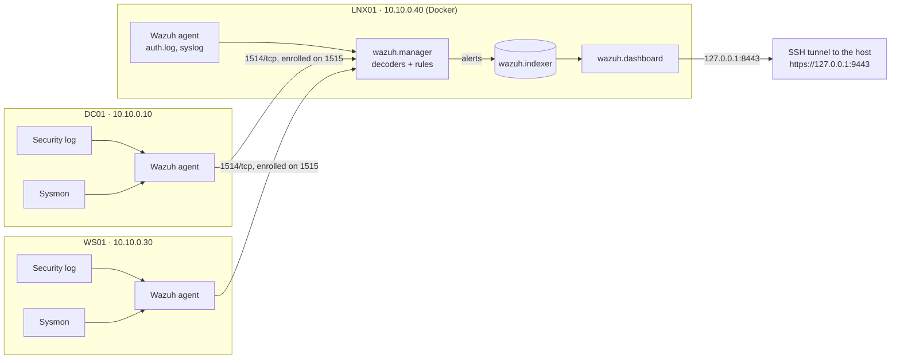

# Wazuh on LNX01 — runbook

Wazuh 4.14.10, single-node Docker deployment (manager, indexer, dashboard) on LNX01, set up 2026-11-16. These are the steps as they were run. Passwords live in `E:\Lab\credenciales-lab.txt` on the host and in `~/.wazuh-pass` (mode 600) on LNX01, never in this repository.

## Log flow

Only 1514 (agent events) and 1515 (enrollment) listen on the lab network. The indexer (9200), the manager API (55000) and the dashboard (8443) listen on 127.0.0.1 only.

## Setup

1. Free memory: LNX01 has 5 GB. Greenbone (week 10) is stopped with its data kept: `cd ~/greenbone && docker compose -p greenbone down` (bring it back with `up -d`).
2. `git clone --depth 1 -b v4.14.10 https://github.com/wazuh/wazuh-docker.git`, then work in `single-node/`.
3. **Replace every default password before the first start.** The admin user's bcrypt hash goes into `config/wazuh_indexer/internal_users.yml` (made with the indexer image's own `plugins/opensearch-security/tools/hash.sh`), and `INDEXER_PASSWORD` / `API_PASSWORD` change in `docker-compose.yml`.
   **Trap:** `config/wazuh_dashboard/wazuh.yml` also holds the API password in plain text and is bind-mounted into the dashboard. Left at the default, the dashboard failed to log in to the API so many times that the API's brute-force protection blocked the dashboard's IP for 5 minutes ("IP blocked due to exceeded number of logins attempts").
4. Ports: `55000` and `9200` bound to `127.0.0.1`; dashboard `127.0.0.1:8443:5601`; syslog `514/udp` removed (nothing uses it).
5. `vm.max_map_count=262144` in `/etc/sysctl.d/90-wazuh.conf` (the indexer refuses to start without it).
6. `docker compose -f generate-indexer-certs.yml run --rm generator`, then `docker compose up -d`.
7. Verified: new passwords return 200, `admin:SecretPassword` and the default API password return 401.

## Agents

- Windows: [`scripts/20-wazuh-agents.ps1`](../scripts/20-wazuh-agents.ps1) (MSI signature checked, copied over PowerShell Direct).
- LNX01: Wazuh apt repository (`signed-by` keyring), `wazuh-agent=4.14.10-1` with `WAZUH_MANAGER=127.0.0.1`, then `apt-mark hold` so a routine upgrade cannot put the agent ahead of the manager.
- Sysmon for every Windows agent comes from the group config [`wazuh/agent.conf`](../wazuh/agent.conf).

## Tuning

- `agents_disconnection_time` lowered from 10m to 2m (lab only, to test the silent-source alert quickly). **Trap:** the container copies `config/wazuh_cluster/wazuh_manager.conf` only on first start, so the running `/var/ossec/etc/ossec.conf` had to be edited too, followed by `wazuh-control restart`.
- [`wazuh/local_rules.xml`](../wazuh/local_rules.xml): rule 100100 lowers PowerShell's own `__PSScriptPolicyTest_*.ps1` file in Temp from level 15 (rule 92213) to level 3. **Trap:** a shell heredoc ate one backslash of `\\+`, so the rule loaded but never matched. Check what the manager actually loaded (`GET /rules?rule_ids=100100`), not what you meant to write.

## Handy queries (on LNX01)

`~/bin/wzq [minutes]` alerts grouped by agent and rule · `~/bin/wzd <rule.id> [minutes] [n]` the last alerts of one rule, key fields only.
